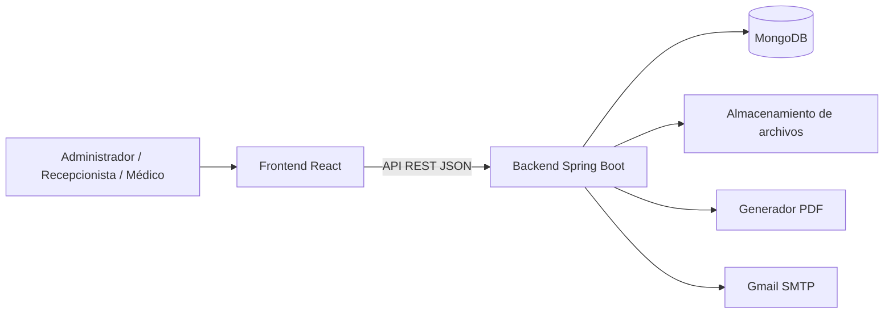
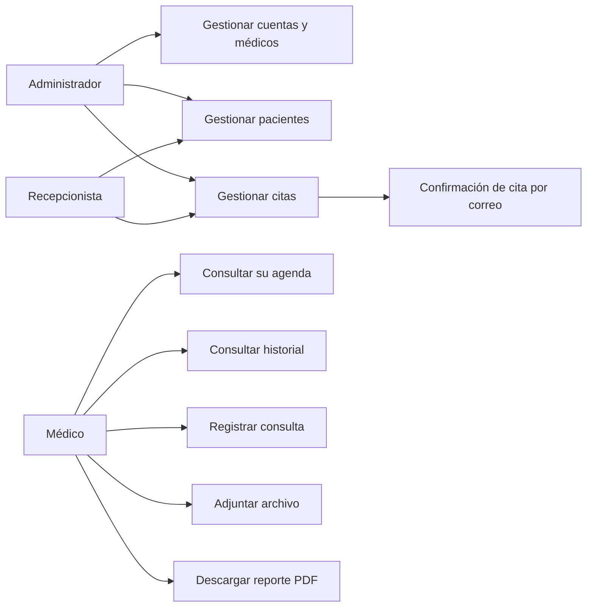
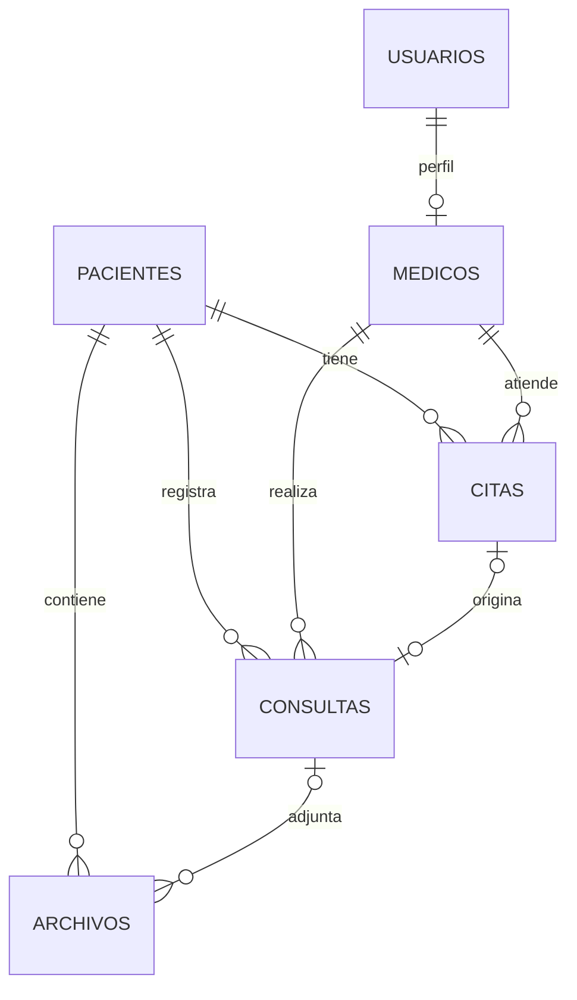

# MediSync — Sistema de Gestión Clínica

> **Estado:** proyecto académico en desarrollo. Esta documentación describe el alcance acordado y distingue las funciones implementadas de las pendientes. **Fecha de entrega: 1 de diciembre de 2026.**

Repositorio: https://github.com/Lowz13/Expedientes-Medicos-TEP

## 1. Propósito y alcance

MediSync es una aplicación web para apoyar la administración de una clínica: gestionar pacientes, médicos y citas; documentar consultas e historiales clínicos; adjuntar y recuperar archivos; generar un reporte PDF; y enviar confirmaciones reales por correo. **Los pacientes no tienen cuenta de acceso.**

El equipo acordó **desarrollar únicamente las funcionalidades necesarias para cumplir los requisitos académicos y el flujo clínico definido**. No se agregarán módulos o características opcionales durante esta entrega.

### Funciones incluidas en el alcance

1. Inicio y cierre de sesión con permisos para **Administrador, Recepcionista y Médico**.
2. Gestión de pacientes y médicos según permisos del rol.
3. Gestión de citas y consulta de agenda, con validación de disponibilidad del médico.
4. Registro de consultas y consulta de historial clínico por personal médico autorizado.
5. Carga y recuperación autorizada de una imagen o un documento PDF asociado a un paciente o consulta.
6. Generación y descarga de un **reporte de consulta en PDF**.
7. **Correo electrónico real** de confirmación de cita mediante SMTP.
8. Persistencia de datos mediante MongoDB.
9. Aplicación ejecutable para la demostración mediante **Docker Compose local o despliegue en la nube**, según la modalidad elegida por el equipo.
10. Pruebas de API con Postman y prueba de rendimiento con k6, con resultados documentados.
11. Repositorio GitHub, documentación, **tres diagramas**, instrucciones de ejecución y demostración.

### Fuera de alcance

Portal o cuentas de pacientes; pagos, facturación e inventario; videollamadas; aplicación móvil; calendario avanzado; recordatorios programados; bandeja o centro de notificaciones interno; analítica, gráficos o reportes administrativos adicionales; módulo de auditoría independiente; integraciones externas distintas del correo requerido. Si el diseño de Stitch incluye alguna de estas opciones, se ocultará o descartará en esta entrega.

## 2. Tecnologías

| Capa | Tecnología acordada | Objetivo |
|---|---|---|
| Frontend | React, Vite, React Router, Axios, Bootstrap/CSS | Interfaz e integración con API |
| Backend | Java 21, Spring Boot 4.1.1, Gradle | API REST y lógica |
| Datos | MongoDB + Spring Data MongoDB | Persistencia |
| Seguridad | Spring Security, BCrypt y validaciones | Autenticación y autorización |
| PDF | PDFBox u OpenPDF, a definir en implementación | Generar reporte |
| Correo | Spring Mail + Gmail SMTP | Confirmación real |
| Despliegue | Docker Compose o nube | Demostración |
| Pruebas | Postman y k6 | API y rendimiento |
| Diseño | Google Stitch, diseño A; Inter y paleta acordada | Consistencia visual |

No todas las dependencias indicadas están instaladas todavía. La tabla representa las **decisiones técnicas para el desarrollo**.

## 3. Roles y permisos

| Operación | Administrador | Recepcionista | Médico |
|---|:---:|:---:|:---:|
| Iniciar sesión | Sí | Sí | Sí |
| Gestionar cuentas y médicos | Sí | No | No |
| Registrar, consultar y editar datos generales de pacientes | Sí | Sí | Consulta necesaria |
| Agendar, consultar y cancelar citas | Sí | Sí | Consultar sus citas |
| Consultar historial clínico | No | No | Sí |
| Registrar consultas | No | No | Sí, propias |
| Adjuntar y descargar documentos clínicos | No | No | Sí, autorizado |
| Generar reporte clínico PDF | No | No | Sí |
| Modificar consultas de otro médico | No | No | No |

**Regla:** los permisos se validan en el backend, no solo ocultando elementos en React. Los médicos autorizados pueden consultar historiales de pacientes, pero no editar consultas creadas por otros médicos. Los roles administrativos no acceden al contenido clínico confidencial.

## 4. Arquitectura

Aplicación web cliente-servidor, sin microservicios.

### Diagrama 1. Componentes



### Diagrama 2. Casos de uso por rol



### Diagrama 3. Modelo lógico de datos previsto



Este esquema es un **modelo lógico de referencia**: las relaciones se validarán en Spring Boot; MongoDB no establece claves foráneas relacionales. Los campos y endpoints se documentarán según se implementen realmente.

## 5. Estructura del repositorio

```text
Expedientes-Medicos-TEP/
├── backend/
│   ├── src/main/java/mx/unam/aragon/tsp/medisync/
│   │   ├── MedisyncApplication.java
│   │   ├── config/
│   │   ├── security/
│   │   ├── controllers/
│   │   ├── dtos/
│   │   ├── models/
│   │   ├── repositories/
│   │   └── services/
│   ├── src/main/resources/
│   ├── src/test/
│   ├── build.gradle
│   ├── settings.gradle
│   ├── gradle/
│   └── gradlew
├── frontend/                 # Preparado; inicialización React pendiente
├── docs/
│   ├── GUIA_EQUIPO.md
│   ├── DISENO.md
│   └── diseño/
├── postman/
├── k6/
├── docker-compose.yml        # Pendiente
├── .env.example              # Pendiente; sin secretos
└── README.md
```

Las líneas marcadas **Pendiente** describen archivos que todavía no existen; no deben interpretarse como implementados. Los paquetes vacíos contienen `.gitkeep` y se completarán a medida que avance el trabajo.

## 6. Estado verificado al reorganizar el repositorio

- `backend/` contiene el proyecto Spring Boot/Gradle, con Java 21 y dependencia `spring-boot-starter-data-mongodb`.
- Se verificó `cd backend && ./gradlew clean compileJava` con resultado **BUILD SUCCESSFUL**.
- Existen los controladores y DTO de pacientes y citas; **actualmente utilizan listas en memoria** y necesitan migración a MongoDB.
- La configuración local incluye `spring.data.mongodb.uri=mongodb://localhost:27017/medisync_db`. **No se ha verificado aquí una conexión real a MongoDB.**
- El frontend React y las funciones de seguridad, envío real de correo, PDF, archivos y despliegue están pendientes de implementar/integrar.
- No afirmar que una funcionalidad está terminada hasta demostrarla mediante ejecución o prueba.

## 7. Instalación y ejecución

**Requisitos actuales:** Git, JDK 21 y conexión para obtener dependencias de Gradle. MongoDB será necesario para el backend cuando se implemente la persistencia.

```bash
git clone https://github.com/Lowz13/Expedientes-Medicos-TEP.git
cd Expedientes-Medicos-TEP/backend
./gradlew clean compileJava
```

Para intentar arrancar la aplicación durante el desarrollo:

```bash
./gradlew bootRun
```

`bootRun` **no está verificado** en este documento y puede requerir que MongoDB esté disponible. En Windows, usar `gradlew.bat`.

**Frontend:** se inicializará dentro de `frontend/` con React/Vite; los comandos definitivos de ejecución se documentarán cuando exista `package.json`.

**Contenedores:** cuando se agregue `docker-compose.yml`, se documentarán aquí los comandos exactos, servicios, puertos, variables de entorno y persistencia. La alternativa de despliegue en nube debe documentarse de igual manera si se elige.

## 8. API y pruebas

Los únicos endpoints básicos identificados en el código de partida son `GET/POST /api/pacientes` y `GET/POST /api/citas`, actualmente **sin persistencia**. Los endpoints para autenticación, médicos, historiales, consultas, archivos y PDF se acordarán entre frontend y backend y se registrarán en la colección Postman. No presentar rutas futuras como funcionales.

- **Postman:** casos positivos, errores de validación, permisos, persistencia, archivos y PDF; guardar colección sin credenciales.
- **k6:** ejecutar una prueba de carga controlada sobre endpoints desarrollados, con datos ficticios; conservar script, resultados y condiciones de la prueba. Evitar el envío masivo de correos reales.
- **Demostración:** login por rol; paciente y médico; cita y correo recibido; consulta e historial; archivo; reporte PDF; persistencia y evidencias Postman/k6.

## 9. Seguridad básica y datos de prueba

Usar datos ficticios, contraseñas almacenadas con hash BCrypt, permisos validados en backend, archivos protegidos y variables de entorno para secretos. **Nunca subir `.env`, contraseñas de aplicación de Gmail, credenciales, documentos médicos reales o datos sensibles**. El correo de confirmación no debe incluir diagnósticos.

## 10. Documentación y colaboración

- [Guía del equipo](docs/GUIA_EQUIPO.md): responsables, reparto de tareas, Git, Conventional Commits y flujo de PR hasta el merge.
- [Reglas de diseño](docs/DISENO.md): identidad visual acordada en Google Stitch, pantallas por rol y criterios de implementación.
- `docs/diseño/`: exportaciones o capturas autorizadas de Stitch, cuando el equipo las incorpore.
- Cada cambio funcional se desarrolla en una rama y se integra a `main` mediante Pull Request revisado.

## 11. Entregables académicos

Aplicación demostrable, al menos un reporte PDF, carga y recuperación de archivo, correo real, GitHub con historial de colaboración, pruebas Postman y k6, documentación con tres diagramas y guía de ejecución, y presentación de demostración. El despliegue será local con Docker o en nube conforme al criterio docente; **no es necesario desarrollar ambos métodos**.
