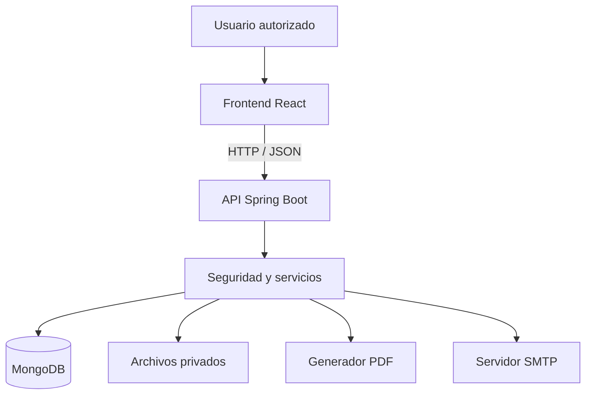
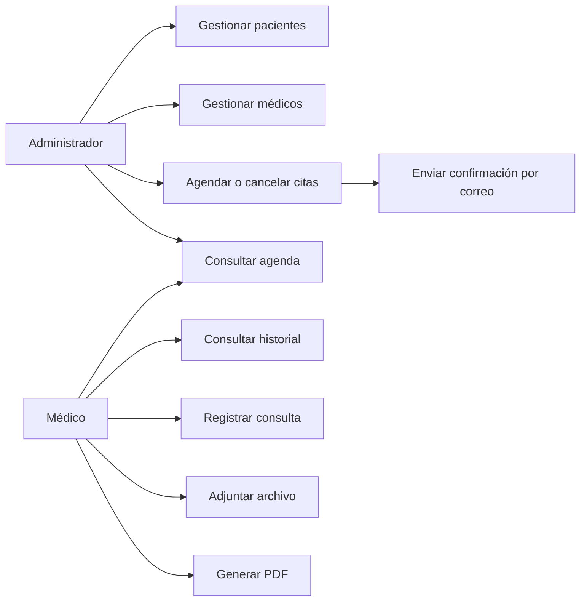
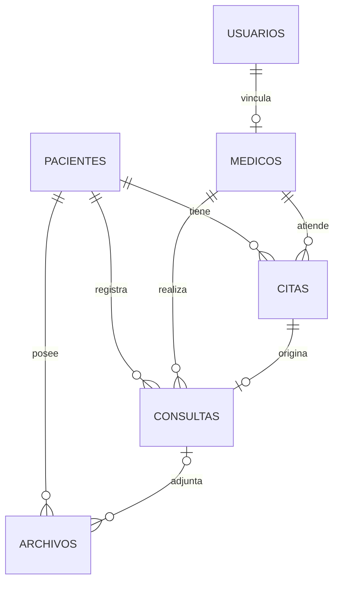

# MediSync — Sistema de Gestión Clínica

> **Estado del proyecto:** en desarrollo (MVP académico). Este documento distingue entre funcionalidades existentes y funcionalidades propuestas; no debe interpretarse como una declaración de que todo está implementado.

## 1. Descripción

**MediSync** es un proyecto académico de aplicación web para administrar pacientes, médicos, citas y consultas en una clínica. Su propósito es centralizar la información, organizar la agenda médica y permitir que el personal autorizado consulte expedientes, adjunte documentos, genere resúmenes de consulta en PDF y envíe confirmaciones de citas por correo electrónico.

**Usuarios del sistema:** administrador y médico. Los pacientes **no** tienen cuentas de acceso. Para el MVP, todos los médicos activos pueden consultar los historiales clínicos de los pacientes registrados; las modificaciones se limitan conforme a permisos específicos.

**Repositorio:** https://github.com/Lowz13/Expedientes-Medicos-TEP

## 2. Alcance del MVP

### Funciones obligatorias previstas

- Inicio y cierre de sesión de administradores y médicos.
- Registro, consulta, búsqueda y edición de pacientes.
- Registro y consulta de médicos.
- Registro, consulta y cancelación de citas; prevención de reservas duplicadas para el mismo médico y horario.
- Registro de consultas e historial clínico por paciente.
- Generación y descarga de un resumen de consulta en PDF.
- Carga y descarga autorizada de documentos PDF o imágenes asociados a pacientes o consultas.
- Envío de correo de confirmación al agendar citas.
- Ejecución local mediante Docker Compose o despliegue accesible para la demostración.
- Colección de pruebas de API en Postman y scripts de rendimiento en K6.

### Fuera del alcance inicial

Portal de pacientes, pagos, facturación, recetas con firma electrónica, inventario, videollamadas, recordatorios automáticos y aplicación móvil nativa.

## 3. Estado actual del código (revisión de `main`, 18 de octubre de 2026)

| Elemento | Estado observado |
|---|---|
| Proyecto Spring Boot en `medisync/` | Existe |
| Configuración Gradle | Existe; requiere validar versiones |
| `GET /api/pacientes`, `POST /api/pacientes` | Implementación básica en memoria |
| `GET /api/citas`, `POST /api/citas` | Implementación básica en memoria |
| DTO de paciente y cita | Existen, con campos mínimos |
| MongoDB y persistencia | No observados |
| React y diseño visual | No observados |
| Inicio de sesión y permisos | No observados |
| Correo electrónico real | No; hay impresión de simulación en consola |
| PDF, carga de archivos, Docker, Postman, K6 | No observados |

**Importante:** los controladores actuales usan listas `ArrayList`; los datos se pierden al reiniciar. No se ha verificado mediante ejecución local que el proyecto compile o arranque. El `build.gradle` observado solicita Spring Boot `4.1.1` y Java `27`; antes de avanzar hay que validar compatibilidad y disponibilidad de esas versiones y acordar una configuración estable para todo el equipo.

## 4. Tecnologías propuestas

| Capa | Tecnología | Uso |
|---|---|---|
| Interfaz | React + Vite | Páginas, formularios, tablas, navegación |
| Estilos | CSS / Bootstrap (por confirmar) | Diseño adaptable |
| API | Java + Spring Boot | API REST y reglas de negocio |
| Seguridad | Spring Security + BCrypt | Autenticación y autorización |
| Datos | MongoDB + Spring Data MongoDB | Persistencia |
| Documentos | PDFBox u OpenPDF (por decidir) | Generación de PDF |
| Correo | Spring Mail + SMTP | Confirmación de citas |
| Archivos | Almacenamiento privado persistente | Adjuntos |
| Contenedores | Docker Compose | Ejecución reproducible |
| Pruebas | Postman y K6 | Pruebas funcionales y de carga |
| Control de versiones | Git + GitHub | Colaboración |

## 5. Arquitectura

Se propone una **aplicación web cliente-servidor** con frontend React y un backend Spring Boot modular (sin microservicios). React consume una API REST en JSON; Spring Boot implementa validaciones, seguridad, persistencia y servicios de archivos/correo/PDF.

### Diagrama 1. Arquitectura de componentes (propuesta)



## 6. Roles y permisos propuestos

| Acción | Administrador | Médico |
|---|:---:|:---:|
| Iniciar sesión | Sí | Sí |
| Crear y editar pacientes | Sí | No |
| Consultar datos generales | Sí | Sí |
| Gestionar médicos | Sí | No |
| Agendar y cancelar citas | Sí | No |
| Consultar agenda | Sí | Sí |
| Ver historiales clínicos | No | Sí, de todos los pacientes |
| Registrar consultas | No | Sí |
| Corregir consultas de otro médico | No | No |
| Adjuntar documentos clínicos | No | Sí |
| Descargar documentos y reportes clínicos | No | Sí |

Los permisos deben aplicarse en el **backend**; ocultar botones en React no protege los datos. Para un MVP, se recomienda registrar auditoría de accesos y cambios clínicos, y no sobrescribir notas médicas sin conservar trazabilidad.

### Diagrama 2. Casos de uso principales (representación de flujo)



## 7. Modelo de datos propuesto

MongoDB utilizará colecciones con referencias por identificador. Los documentos clínicos se mantienen separados de los datos generales de pacientes.

| Colección | Campos principales |
|---|---|
| `usuarios` | `_id`, `nombre`, `correo`, `passwordHash`, `rol`, `activo`, `createdAt` |
| `medicos` | `_id`, `usuarioId`, `nombre`, `especialidad`, `cedulaProfesional`, `horario`, `activo` |
| `pacientes` | `_id`, `nombre`, `fechaNacimiento`, `telefono`, `correo`, `alergias`, `antecedentes`, `activo` |
| `citas` | `_id`, `pacienteId`, `medicoId`, `fechaHora`, `duracionMinutos`, `motivo`, `estado` |
| `consultas` | `_id`, `pacienteId`, `medicoId`, `citaId`, `fechaConsulta`, `sintomas`, `diagnostico`, `tratamiento`, `observaciones` |
| `archivos` | `_id`, `pacienteId`, `consultaId`, `nombreOriginal`, `tipoMime`, `tamanoBytes`, `rutaAlmacenamiento`, `subidoPor` |
| `auditoria` (recomendada) | `_id`, `usuarioId`, `accion`, `recurso`, `recursoId`, `fecha`, `resultado` |

### Diagrama 3. Relaciones de entidades (modelo lógico propuesto)



Las relaciones no son claves foráneas de MongoDB: Spring Boot debe validar la existencia de referencias. Para citas de duración fija, se recomienda un índice único parcial por `medicoId` + `fechaHora` cuando `estado = PROGRAMADA` y manejo de conflictos concurrentes.

## 8. Contrato preliminar de API

**Las dos primeras parejas de rutas existen en el código actual; las demás son propuestas y no deben considerarse implementadas.** Prefijo `/api`.

| Método | Ruta | Propósito | Estado |
|---|---|---|---|
| GET | `/api/pacientes` | Listar pacientes | Básico, en memoria |
| POST | `/api/pacientes` | Crear paciente | Básico, en memoria |
| GET | `/api/citas` | Listar citas | Básico, en memoria |
| POST | `/api/citas` | Agendar cita | Básico, en memoria |
| POST | `/api/auth/login` | Autenticar usuario | Planeado |
| GET | `/api/doctores` | Listar médicos | Planeado |
| POST | `/api/doctores` | Crear médico | Planeado |
| GET | `/api/pacientes/{id}/historial` | Consultar historial | Planeado |
| POST | `/api/consultas` | Registrar consulta | Planeado |
| GET | `/api/consultas/{id}/reporte` | Descargar PDF | Planeado |
| POST | `/api/pacientes/{id}/archivos` | Adjuntar archivo | Planeado |
| GET | `/api/archivos/{id}` | Descargar archivo autorizado | Planeado |
| PATCH | `/api/citas/{id}/cancelar` | Cancelar cita | Planeado |

Los nombres y estructuras JSON deben fijarse entre backend y frontend antes de implementar las pantallas. Se recomienda responder `400` ante datos inválidos, `401` sin autenticación, `403` sin permisos, `404` si no existe el recurso y `409` ante horarios ocupados.

## 9. Estructura del repositorio

### Estructura observada

```text
Expedientes-Medicos-TEP/
├── .vscode/
├── README.md
└── medisync/
    ├── build.gradle
    ├── gradlew
    ├── gradlew.bat
    ├── src/main/java/mx/unam/aragon/tsp/medisync/
    │   ├── MedisyncApplication.java
    │   └── expedientes/
    │       ├── controllers/
    │       │   ├── PacienteController.java
    │       │   └── CitaController.java
    │       └── dtos/
    │           ├── PacienteDto.java
    │           └── CitaDto.java
    └── src/main/resources/application.properties
```

### Estructura prevista

```text
Expedientes-Medicos-TEP/
├── medisync/             # backend existente; añadir models, repositories, services, security
├── frontend/             # React + Vite
├── postman/              # colección y entorno sin secretos
├── k6/                   # scripts de carga
├── docs/                 # diagramas y evidencias
├── docker-compose.yml   # pendiente de implementar
├── .env.example          # valores de ejemplo, nunca secretos
└── README.md
```

## 10. Cómo ejecutar el proyecto

### Estado actual: ejecución del backend (pendiente de validar)

**Requisitos:** Git, JDK compatible con `medisync/build.gradle` y conexión a internet para descargar dependencias. Actualmente el build declara Java 27; comprobar primero que el equipo cuenta con esa versión o acordar un ajuste de Java/Spring Boot/Gradle.

```bash
git clone https://github.com/Lowz13/Expedientes-Medicos-TEP.git
cd Expedientes-Medicos-TEP/medisync
./gradlew bootRun
```

En Windows, usar `gradlew.bat bootRun`. Estos comandos son **instrucciones tentativas**, no una ejecución verificada. La configuración actual no incluye MongoDB ni frontend.

### Ejecución final esperada (todavía no disponible)

Una vez creados `docker-compose.yml`, los Dockerfile y `.env.example`, el flujo previsto será:

```bash
cp .env.example .env
docker compose up --build -d
docker compose ps
```

Documentar después los puertos reales, URL de acceso, credenciales **de demostración** y pasos para detener el sistema (`docker compose down`). No publicar contraseñas reales ni incluir datos clínicos reales.

## 11. Pruebas y aceptación

### Postman (pendiente)

Preparar una colección con pruebas de login, creación y búsqueda de pacientes, médicos, citas, consultas, generación de PDF, subida de archivos, autorizaciones y casos inválidos. Guardar colección y variables de entorno de ejemplo en `postman/`.

### K6 (pendiente)

Medir endpoints de lectura y registro con datos ficticios. Meta inicial sugerida: **95% de respuestas de consultas GET por debajo de 2 segundos con 10 usuarios virtuales**, medida en un entorno documentado; no es un resultado ya obtenido. Evitar pruebas de carga sobre datos reales o correos reales.

### Criterios de aceptación de la demo

1. Iniciar sesión como administrador.
2. Registrar paciente y médico.
3. Agendar una cita y comprobar envío real de correo.
4. Intentar una reserva duplicada y obtener rechazo.
5. Iniciar sesión como médico y consultar historial.
6. Registrar consulta y adjuntar PDF o imagen.
7. Descargar resumen de consulta PDF.
8. Reiniciar contenedores y comprobar persistencia.
9. Mostrar evidencias de Postman y K6.

## 12. Seguridad y privacidad

- Utilizar únicamente **datos ficticios** en desarrollo y demostración.
- Contraseñas con BCrypt; secretos por variables de entorno, nunca en Git.
- Autorización por rol aplicada en cada endpoint y cada descarga.
- Validación de archivos (tipo, tamaño y contenido); nombres internos no predecibles; almacenamiento fuera de rutas públicas.
- Evitar incluir diagnósticos o información sensible en correos de confirmación.
- Registrar accesos a historiales y operaciones críticas cuando sea viable.
- Configurar CORS solo para orígenes autorizados y HTTPS en despliegues externos.
- No considerar este MVP listo para producción ni para expedientes clínicos reales sin revisión de seguridad, privacidad y obligaciones legales aplicables.

## 13. Equipo

| Área | Integrantes | Responsabilidad |
|---|---:|---|
| Backend | 2 | API, persistencia, seguridad, citas, consultas, PDF, correo y archivos |
| Frontend | 2 | Diseño de interfaz, React, formularios, navegación, integración y pruebas visuales |

## 14. Entregables académicos

- Sistema funcional y accesible en la demostración (si es local, dockerizado).
- Un reporte PDF descargable.
- Almacenamiento y recuperación de un archivo.
- Notificación real por correo.
- Código en GitHub.
- Colección Postman y scripts K6.
- README con descripción, diagramas e instrucciones de arranque.
- Presentación con cámara encendida y demo ensayada.

## 15. Referencias del proyecto

- Repositorio: https://github.com/Lowz13/Expedientes-Medicos-TEP
- Spring Boot: https://spring.io/projects/spring-boot
- React: https://react.dev/
- MongoDB: https://www.mongodb.com/docs/
- Docker Compose: https://docs.docker.com/compose/
- K6: https://grafana.com/docs/k6/latest/

---

**Nota de mantenimiento:** actualizar la tabla de estado, las instrucciones de ejecución y las rutas cada vez que se integren funcionalidades. No marcar como terminadas las que no estén verificadas.
